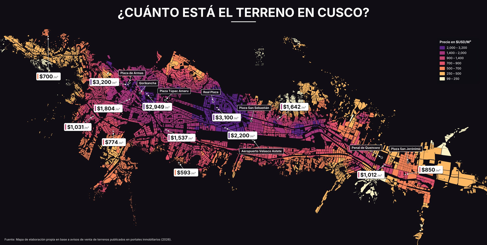
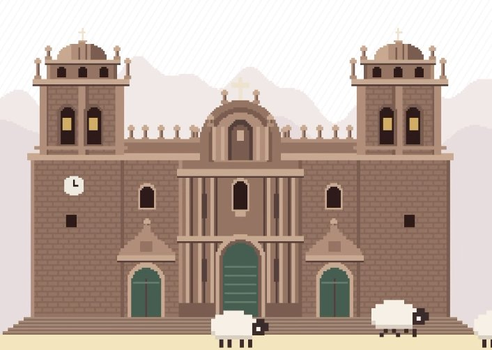
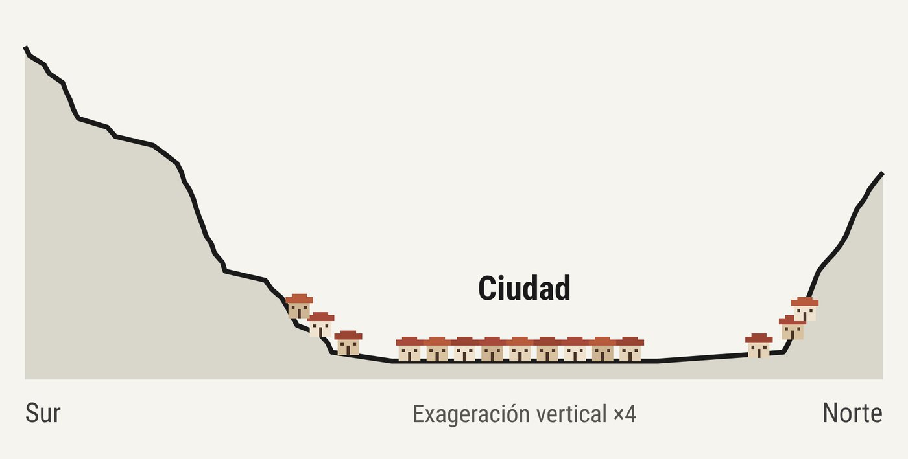
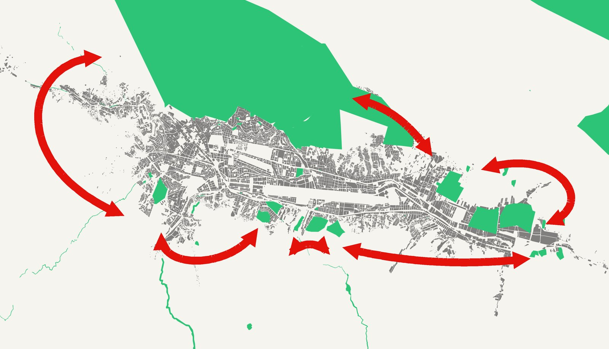
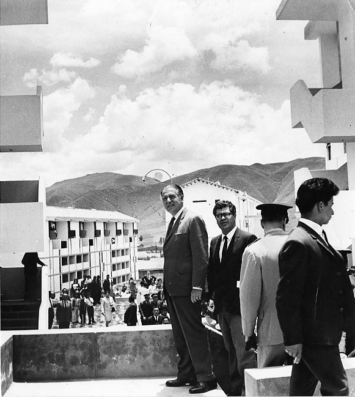

A la pregunta de si los terrenos del Cusco son más caros que los de Lima, la respuesta corta es **no, pero casi**. El distrito financiero de San Isidro es ligeramente más caro que el centro del Cusco. Y eso ya es sintomático de una ciudad que, sin tener los ingresos y salarios de Lima, cuesta como Lima. A continuación desarrollaremos los factores que han determinado este fenómeno y que ha tenido consecuencias sociales para los cusqueños residentes.

<figure class="cs-fig cs-ancha">

<figcaption>Precio de oferta del m² de terreno por manzana, en dólares. Fuente: mapa de elaboración propia en base a avisos de venta de terrenos publicados en portales inmobiliarios (2026).</figcaption>
</figure>

Por supuesto, hay varios factores que explican estos elevadísimos precios del terreno. Esta vez nos detendremos en cuatro: turismo, geografía, burocracia y MINCUL (AKA Ministerio de Cultura).

## 1. Turismo

Es la ciudad más turística del Perú, y la demanda turística presiona los precios. Hoy en el centro del Cusco, una bebida o un almuerzo cuesta tanto como en el restaurante más caro de Lima.

<figure class="cs-fig cs-angosta">

<figcaption>La más turística del Perú: la demanda turística presiona los precios.</figcaption>
</figure>

## 2. Geografía

El Cusco ocupa el fondo de un valle en forma de U. La topografía limita el suelo que se puede urbanizar. Las laderas, en la mayoría de casos, no son urbanizables, están declaradas en riesgo o construir ahí resulta muy oneroso.

<figure class="cs-fig">

<figcaption>Perfil topográfico aproximado sur–norte del valle del Cusco (exageración vertical ×4). Elaboración propia a partir de curvas de nivel.</figcaption>
</figure>

## 3. MINCUL y restos arqueológicos

La ciudad está rodeada por zonas arqueológicas. La presionan desde afuera y desde adentro. Solo en la provincia del Cusco (no confundir con la región Cusco), el Ministerio de Cultura registra 110 áreas delimitadas. La más grande es el Parque Arqueológico de Saqsaywaman, con una extensión total de 2,997.26 hectáreas y 96 sitios arqueológicos.

Dentro de la ciudad, si tienes el infortunio de que tu terreno se encuentre en algún polígono del MINCUL, los trámites para la licencia de construcción serán carísimos, infinitos y kafkianos. Esto obliga a los cusqueños a vender sus propiedades a personas con recursos, expulsándolos en la práctica. La castrante normativa del MINCUL impide otras formas de habitar la ciudad.

<figure class="cs-fig">

<figcaption>En verde, las zonas arqueológicas delimitadas; en gris, las manzanas urbanas. Fuente: Ministerio de Cultura (SIGDA), INEI, OpenStreetMap; elaboración propia.</figcaption>
</figure>

## 4. Burocracia municipal

Puede pasar un año antes de conseguir una licencia de construcción. Este trámite laberíntico ha encarecido los costos de la vivienda formal, pues el acompañamiento de los profesionales durante todo ese tiempo se traslada al costo final de la vivienda.

<figure class="cs-fig cs-angosta">

<figcaption>Hasta un año para obtener una licencia de construcción.</figcaption>
</figure>

## Y por qué nunca podrás comprar una casa

Menos suelo disponible, más demanda y trámites lentos: el resultado es un terreno cada vez más caro. Cuando el m² del centro se acerca a lo que cuesta en San Isidro, comprar una casa en tu propia ciudad deja de estar al alcance de quien vive y trabaja en el Cusco. Algunos números.

Para un departamento de US$ 120,000 (unos S/ 410,400), sin crédito hipotecario:

<table class="cs-tabla-casa">
<thead><tr><th>Ingreso mensual</th><th>Ahorrando el 100 % del sueldo</th><th>Ahorrando el 50 % del sueldo</th></tr></thead>
<tbody>
<tr><td>RMV, S/ 1,230</td><td>28 años</td><td><strong>56 años</strong></td></tr>
<tr><td>Promedio Cusco, S/ 2,060</td><td>17 años</td><td><strong>33 años</strong></td></tr>
</tbody>
</table>

<ul class="cs-notas">
<li>RMV es el sueldo mínimo en el Perú.</li>
<li>50 % significa destinar la mitad del sueldo mensual a la compra y usar la otra mitad para vivir.</li>
</ul>

Sí, es un título quizás alarmista, pero lo cierto es que lo más probable es que el cusqueño promedio alquile antes que compre. A eso hay que añadir que el 80 % de los trabajadores de la región son informales, así que el acceso a la banca hipotecaria es lejano. Sumémosle cero intervención estatal para promover el acceso a la vivienda. Muy atrás quedaron los años en que el Estado construyó los complejos habitacionales de Mariscal Gamarra, Zarumilla, Ttio y otros.

<figure class="cs-fig cs-angosta">

<figcaption>El presidente Fernando Belaunde recorriendo Mariscal Gamarra. Década de 1960, primer gobierno.</figcaption>
</figure>

## ¿Cómo se hizo el mapa?

Recogimos 250 avisos de venta de terrenos publicados en 2026 y los llevamos a un mapa. Con un modelo espacial estimamos el precio del m² en las aproximadamente 7,500 manzanas de la ciudad.

- **Lo más caro:** el entorno de la Plaza de Armas, con hasta US$ 3,200 por m², y los ejes de Wanchaq y la Av. de la Cultura.
- **Lo más barato:** las laderas y la periferia, con menos de US$ 250 por m².

El mapa muestra cuánto cuesta el metro cuadrado de terreno en la ciudad del Cusco, manzana por manzana. Partimos de 250 avisos de venta de terrenos publicados en portales inmobiliarios durante 2026. Ubicamos cada aviso en el mapa y anotamos su precio por m² en dólares.

Con esos 250 puntos estimamos el precio de las 7,500 manzanas de la ciudad. La idea es simple: una manzana sin aviso toma el precio de sus vecinas con aviso, y pesan más las que están más cerca. Todo el trabajo se hizo en QGIS, un software libre de sistemas de información geográfica.

### Nota metodológica

- **Datos:** 250 precios de oferta de terrenos (US$/m²), tomados de avisos publicados en portales inmobiliarios en 2026 y georreferenciados como puntos en QGIS.
- **Base cartográfica:** las 7,500 manzanas urbanas de la provincia del Cusco según el INEI, en WGS 84 / UTM zona 19S (EPSG:32719).
- **Asignación a manzanas:** cada aviso se asignó a la manzana que lo contiene o, si cae en la vía, a la más cercana a menos de 30 m. Si una manzana recibió varios avisos, se usó la mediana. Así se obtuvieron 74 manzanas con precio observado.
- **Interpolación espacial (IDW logarítmico):** el precio de las demás manzanas se estimó por ponderación de distancia inversa, a partir de los 10 avisos más cercanos. Se trabajó sobre el logaritmo del precio para que los valores muy altos no se extiendan en exceso a su entorno.

El resultado no es un precio oficial ni una tasación. Es una fotografía aproximada de cuánto piden hoy los vendedores por un m² de suelo en cada zona del Cusco. Precios de oferta, no de cierre.

**Fuentes:** Ministerio de Cultura (SIGDA); Andina (2024); INEI; OpenStreetMap; elaboración propia en QGIS.
