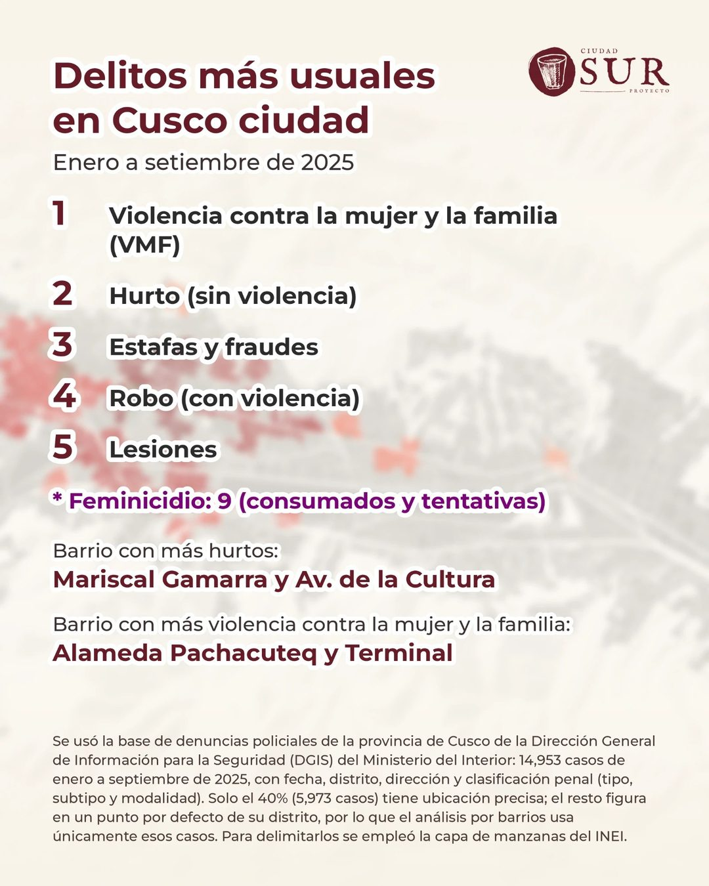
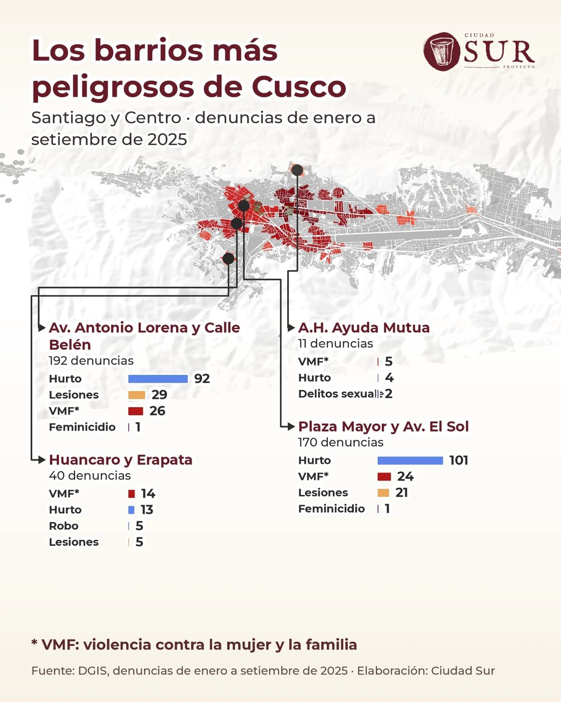
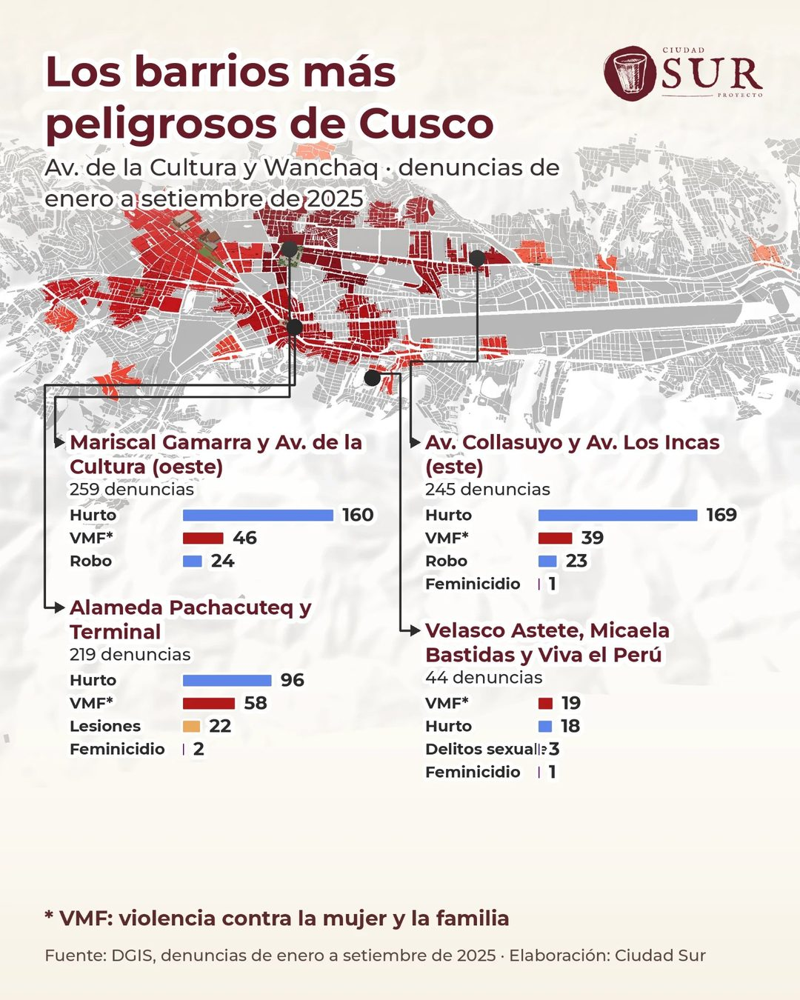
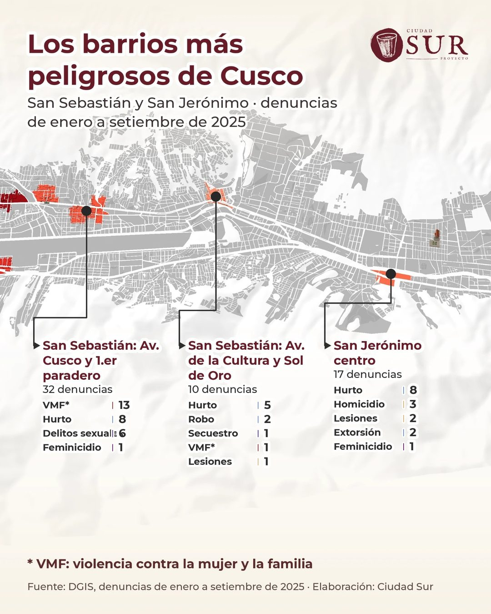

Por el Laboratorio Urbano del Cusco - Ciudad Sur Fuente: base de denuncias policiales DGIS-Ministerio del Interior, enero a setiembre de 2025 (14 953 casos). Procesamiento y mapas: Ciudad Sur, con QGIS y la capa de manzanas del INEI.

Según diversas encuestas publicadas en la época electoral del presente año, una de las principales preocupaciones del ciudadano cusqueño era la inseguridad. Y a pesar de que la ciudad del Cusco no lidera los rankings de inseguridad en el país, lo cierto es que sí existe una percepción de inseguridad. El objetivo de este trabajo fue verificar si esa inseguridad se plasma en el territorio.

## Sobre la fuente: más de 14 000 denuncias

Trabajamos con la base de denuncias policiales de la provincia de Cusco de la Dirección General de Información para la Seguridad (DGIS) del Ministerio del Interior. Son 14 953 casos registrados entre enero y setiembre de 2025. Cada caso tiene fecha, distrito, dirección y clasificación penal (tipo, subtipo y modalidad).

Hay que precisar algo desde el inicio: son denuncias, no todos los delitos que ocurren. Muchos hechos nunca se denuncian, sobre todo los robos menores y la violencia dentro del hogar. Las cifras muestran lo que llega a la comisaría y, aun así, permiten ver patrones claros.

## Limitaciones: el problema de la ubicación

No todas las denuncias sirven para hacer un mapa fino. Solo el 40 % (5 973 casos) tiene una ubicación precisa. El otro 60 % está registrado en un punto por defecto de su distrito, que suele ser un punto central y genérico. Si los usáramos, aparecerían "focos de delito" que en realidad son solo el lugar donde el sistema guarda los casos sin dirección exacta.

Por eso el análisis por barrios usa únicamente los casos con ubicación precisa. Así perdemos cantidad, pero ganamos exactitud: cada punto del mapa está donde ocurrió el hecho.

## ¿Por qué barrios y no distritos?

Los distritos de la ciudad (Cusco, Wanchaq, Santiago, San Sebastián y San Jerónimo) son demasiado grandes y diversos por dentro. Wanchaq, por ejemplo, incluye zonas residenciales tranquilas y también el entorno del terminal terrestre, pegado al distrito de Santiago y con una dinámica muy distinta. Dar un solo número por distrito esconde esas diferencias.

Por eso dividimos la ciudad en 12 barrios o sectores, delimitados con la capa de manzanas del INEI. Cada sector agrupa manzanas con una identidad urbana reconocible, como el Centro Histórico, la Av. de la Cultura o el entorno del Terminal. Luego contamos cuántas denuncias de cada tipo caen dentro de cada uno. Así el resultado se lee como la gente vive la ciudad: por zonas, no por límites administrativos.

## Qué delitos contamos, y por qué

La base de la DGIS clasifica las denuncias en 32 tipos. Los usamos de dos formas.

**En el mapa general** (el de la portada de esta nota) aparecen los 32 tipos de delito. Cada denuncia con ubicación precisa es un punto, con un color según su tipo. Es la foto completa de lo denunciado en la ciudad.

**En el ranking por barrios** nos quedamos con 12 categorías, que son las que expresan violencia o ataques directos contra las personas y su patrimonio en el espacio urbano:

- Violencia contra la mujer y la familia (VMF)
- Hurto
- Robo
- Daños
- Extorsión
- Lesiones
- Homicidio
- Feminicidio
- Delitos sexuales
- Acoso
- Secuestro
- Violación de domicilio

Dejamos fuera cuatro grupos:

- **Faltas:** son infracciones menores y no delitos propiamente dichos. Inflarían los conteos sin decir mucho sobre peligrosidad.
- **Delitos contra la seguridad pública:** por ejemplo, conducir en estado de ebriedad o tener armas sin licencia. Son importantes, pero no tienen una víctima directa en el lugar.
- **Delitos informáticos:** ocurren en el espacio digital. La dirección registrada suele ser el domicilio de la víctima, no el "lugar del delito".
- **Delitos culposos:** son hechos sin intención, como muchos accidentes de tránsito. No miden violencia deliberada.

## Resultados: qué se denuncia más en la ciudad

Entre enero y setiembre de 2025, los cinco delitos más denunciados en la ciudad del Cusco fueron:

1. Violencia contra la mujer y la familia (VMF)
2. Hurto (sin violencia)
3. Estafas y fraudes
4. Robo (con violencia)
5. Lesiones

<figure class="cs-lamina"></figure>

El primer lugar es el dato más fuerte del análisis. **El delito más denunciado en el Cusco no ocurre en la calle, sino sobre todo dentro de las casas.** La violencia contra la mujer y la familia supera al hurto y al robo, que suelen dominar la conversación pública sobre inseguridad.

A eso se suman 9 feminicidios, entre consumados y tentativas, en solo nueve meses.

## Resultados: dónde se concentra

- **El barrio con más hurtos es Mariscal Gamarra y Av. de la Cultura.** Es un eje de mucho movimiento: comercio, universidades, oficinas y transporte. Allí hay mucha gente, pertenencias a la vista y la facilidad de perderse entre la multitud. Es el escenario típico del hurto.
- **El barrio con más violencia contra la mujer y la familia es Alameda Pachacuteq y Terminal.** Esto indica que la violencia doméstica también tiene una geografía, y que ciertas zonas necesitan atención específica en prevención y protección, no solo patrullaje.

<figure class="cs-lamina"></figure>

<figure class="cs-lamina"></figure>

<figure class="cs-lamina"></figure>

## Lo que el mapa nos dice

La inseguridad en el Cusco tiene dos caras. Una es visible: el hurto y el robo en los ejes comerciales y de tránsito. La otra es menos visible y más frecuente: la violencia contra la mujer y la familia. Las políticas de seguridad que solo piensan en cámaras y serenazgo atienden la primera y dejan de lado la segunda.

Conocer dónde ocurre cada tipo de delito permite diseñar respuestas distintas para cada barrio. Ese es el sentido de mirar la ciudad por sectores.

## ¿Qué pasó con Zarzuela o Picchu?

Ambos son sectores tradicionalmente conocidos como peligrosos; sin embargo, no figuran en nuestro mapa. Hay diferentes razones, algunas objetivas y otras metodológicas.

Primero, las objetivas, en particular en el caso de Zarzuela: esa percepción viene de años atrás, pero en años más recientes la consolidación urbana, la llegada de servicios y una mejor infraestructura vial y equipamiento urbano han hecho que disminuyan los casos de inseguridad ciudadana. Sin embargo, en la memoria colectiva del cusqueño aún continúa.

<table class="cs-tabla">
  <thead><tr><th>Barrio</th><th class="num">Denuncias</th><th class="num">Con ubicación precisa</th><th class="num ocultable">En punto por defecto</th></tr></thead>
  <tbody>
    <tr><td>Zarzuela (Alta y Baja, Santiago)</td><td class="num">99</td><td class="num">16 (16 %)</td><td class="num ocultable">83</td></tr>
    <tr><td>Picchu (Alto, La Rinconada, San Isidro)</td><td class="num">92</td><td class="num">2 (2 %)</td><td class="num ocultable">90</td></tr>
    <tr><td>Promedio de la base</td><td class="num">-</td><td class="num">40 %</td><td class="num ocultable">60 %</td></tr>
  </tbody>
</table>

Fuente: DGIS-Mininterior, enero a setiembre de 2025. Elaboración: Ciudad Sur.

Las pocas denuncias que sí tienen ubicación (16 de Zarzuela y 2 de Picchu) caen fuera de los 12 barrios. Ninguno de los dos quedó dentro de un sector delimitado.

El 84 % de los casos de Zarzuela y el 98 % de los de Picchu terminaron en el punto por defecto del distrito y no en una ubicación precisa. Para el mapa, estos barrios son casi invisibles.

## Ranking por distritos

Finalmente, si hacemos un ranking de los distritos más peligrosos considerando todas las denuncias, las que tienen ubicación precisa y las que no, el resultado es el siguiente:

<table class="cs-tabla">
  <thead><tr><th>#</th><th>Distrito</th><th>Denuncias</th><th class="num">VMF</th><th class="num">Hurto y robo</th></tr></thead>
  <tbody>
    <tr><td>1</td><td>Cusco</td><td>3 904</td><td class="num">1 221</td><td class="num">1 156</td></tr>
    <tr><td>2</td><td>Santiago</td><td>3 271</td><td class="num">1 260</td><td class="num">697</td></tr>
    <tr><td>3</td><td>San Sebastián</td><td>2 815</td><td class="num">1 191</td><td class="num">501</td></tr>
    <tr><td>4</td><td>Wanchaq</td><td>2 684</td><td class="num">507</td><td class="num">878</td></tr>
    <tr><td>5</td><td>San Jerónimo</td><td>1 663</td><td class="num">679</td><td class="num">323</td></tr>
    <tr><td>6</td><td>Saylla</td><td>298</td><td class="num">128</td><td class="num">52</td></tr>
    <tr><td>7</td><td>Poroy</td><td>295</td><td class="num">129</td><td class="num">55</td></tr>
    <tr><td>8</td><td>Ccorca</td><td>23</td><td class="num">9</td><td class="num">5</td></tr>
  </tbody>
</table>

Fuente: DGIS-Mininterior, enero a setiembre de 2025 (14 953 denuncias). Elaboración: Ciudad Sur.

## Nota metodológica

Base de denuncias policiales de la provincia de Cusco, DGIS-Ministerio del Interior, enero a setiembre de 2025 (14 953 casos). El análisis por barrios usa solo los 5 973 casos con ubicación precisa (40 %). Los barrios se delimitaron con la capa de manzanas del INEI. Para la elaboración de los mapas se usó el software QGIS.

Un trabajo del Laboratorio Urbano del Cusco de Ciudad Sur. Cómo citar: Ciudad Sur (2026). <i>¿Cuáles son los barrios más peligrosos del Cusco? Geografía de la violencia</i>. Laboratorio Urbano del Cusco. Se permite reproducir citando la fuente.

